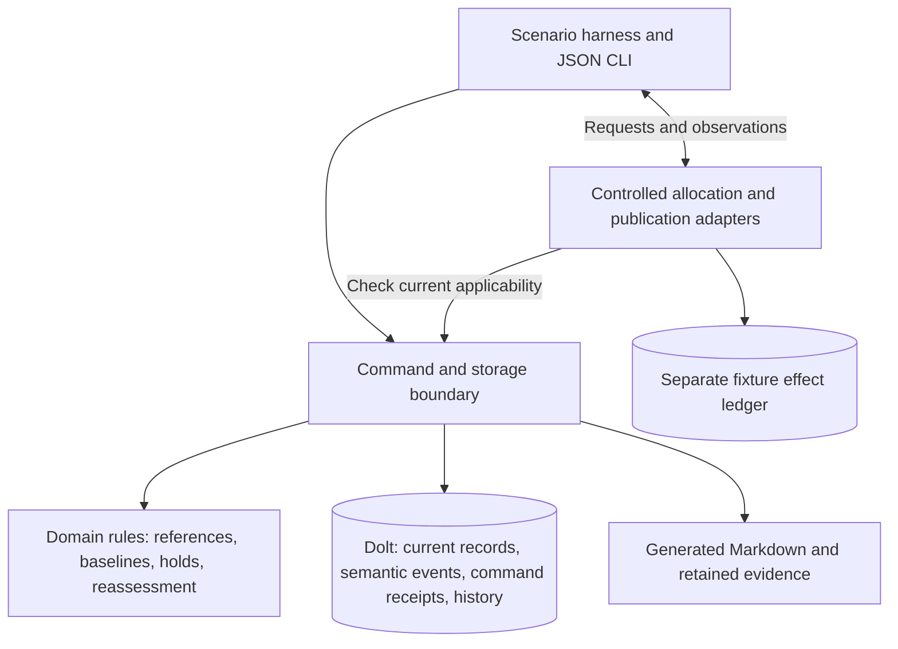

# Continuity

**Proof of concept:** make the reasoning behind work explicit, preserve it across sessions, and reassess dependent work when assumptions are invalidated.

Continuity explores whether a workflow-owned data model, stored directly in [Dolt](https://github.com/dolthub/dolt), can keep requirements, assumptions, decisions, plans, and execution evidence connected across sessions. The implementation is an isolated Bun command-line harness using real Dolt, synthetic work, and controlled effect adapters. It is not integrated into another application.

## Purpose

Tracking a task's status does not explain why its requirements exist, which assumptions support a decision, or what needs reconsideration when those assumptions fail. When that reasoning is scattered across issues, documents, and conversations, a later session has to reconstruct it and may continue work on an invalid basis.

The experiment asks whether those relationships can be explicit, durable, and actionable:

- Reuse canonical requirements, assumptions, and decisions by reference across work items and sessions, preserving their identity and revision history.
- Trace an invalidated assumption through the requirements, decisions, and tasks that rely on it, and hold affected work for reassessment.
- Record the operator's revised basis and clearance, then associate subsequent verification and delivery evidence with the approved version of the work.

Dependencies are explicitly recorded. The proof does not infer whether an assumption is true or discover reasoning that was never captured.

## Architecture



The [domain model](proof/src/model.ts) owns canonical record revisions, dependency traversal, execution state, holds, and operator-only reassessment. Approved baselines pin the knowledge and task definitions used by an execution attempt. Verification applies to that baseline and source revision, so recording a result does not itself make the result stale.

The [storage boundary](proof/src/store.ts) checks command identity and expected revision, applies the domain rules, and writes changed records, a semantic event, and a command receipt in one SQL transaction. Dolt's transaction-commit setting creates version history at that boundary. Repeating a command returns its original result; stale or rejected commands leave no partial changes.

The [controlled adapters](proof/src/adapters.ts) simulate allocation and publication effects in a separate durable fixture ledger. This lets the scenario lose a response and reconcile the existing effect without dispatching it again. Pause acknowledgements and operator decisions are supplied by the harness. No real workers, checkout operations, or publications are controlled.

This prototype uses a single writer and typed JSON records in separate SQL tables. Referential and transition rules are enforced in the application layer. Generated documents are views of the stored records.

## What the proof exercises

1. Create requirements, decisions, and an assumption; reuse their canonical references in two work items and approve their plans.
2. Start controlled execution, invalidate the shared assumption, and identify affected work through its recorded dependencies.
3. Record pause requests and acknowledgements, leaving unrelated work runnable. A later reference to the invalidated assumption also acquires a hold.
4. Recover the same work and holds from a fresh process. Reject agent clearance and stale operator decisions.
5. Record an operator-approved replacement basis, clear only the covered holds, and resume that work while other affected work remains held.
6. Record verification against the current baseline and source, simulate publication with a lost response, and reconcile its receipt without duplicating the fixture effect.

The [recorded run](proof/evidence/run-status.json) passed the real-Dolt storage gate, six domain regression tests, strict TypeScript checking, and all 15 lifecycle acceptance groups. [Named checks](proof/evidence/acceptance.json), [requirement-to-evidence links](proof/evidence/requirement-evidence.json), and [generated document views](proof/evidence/views/) are retained in the repository.

These results establish the tested model and persistence behavior. Live application integration, actual worker interruption, production authentication, distributed concurrency, disaster recovery, and production-scale performance remain unproven. See the [assessment](proof/assessment.md) for findings and the proposed next experiment.

## Run the proof

The current runner targets macOS ARM64 with Bun 1.4.5. The first run needs network access for dependencies and the checksum-verified Dolt 2.7.6 download; the binary stays inside the workspace.

```sh
cd proof
bun install --frozen-lockfile --ignore-scripts
bun run acceptance
```

The runner starts a fresh isolated database, executes the checks, retains evidence, and stops its own server. The [detailed proof guide](proof/README.md) explains the commands, storage contract, manual inspection, and resource ownership.

## Design and evidence

- [Socrates specification](.socrates/20261123-090140/spec.md): agreed requirements and authority boundaries.
- [Implementation plan](.socrates/20261123-090140/plan.md) and [independent critique](.socrates/20261123-090140/plan-critique.md).
- [Execution record](.socrates/20261123-090140/execution.md): implementation and acceptance conditions.
